<div align="center">


<a href="https://git.io/typing-svg">
  
</a>

<br/>

[](https://www.linkedin.com/in/umithavare/)
[](https://medium.com/@umithavare)
[](https://instagram.com/umithavare)
[](https://www.hackerrank.com/profile/umithavare16)
[](mailto:umithavare@gmail.com)
[](https://github.com/umithavare)

</div>

---

## 👋 About Me

```yaml
name: Ümit Havare
location: Istanbul, Turkey 🇹🇷
role: Software Developer @ Wechip
focus:
  - .NET backends (C#, ASP.NET Core)
  - Payment systems (virtual POS, 3D Secure, ISO 8583)
  - Modular monoliths, microservices, event-driven design
  - GraphQL federation with HotChocolate Fusion
side_quests:
  - ZONEBOUND: INFINITE, a 3D mobile action RPG in Unity 6
  - Tools that keep AI coding agents on track
fun_fact: "My first Java text adventure is turning into a 3D mobile game."
```

- 🏦 By day I build **payment infrastructure**: virtual POS flows, 3D Secure and ISO 8583 messaging on **.NET**
- 🧩 I like **modular monoliths** with clear module boundaries, **Clean Architecture**, **DDD**, **CQRS** and the **Outbox pattern**
- 🎮 After hours I'm building **ZONEBOUND: INFINITE**, a dark-fantasy action RPG for Android & iOS made with **Unity 6 + C#**
- 🤖 I build tools around **AI coding agents** like Claude Code and Codex CLI
- 📝 I write about **.NET and GraphQL** on [Medium](https://medium.com/@umithavare)
- 💬 Ask me about **C#, .NET, GraphQL, RabbitMQ, PostgreSQL, payment flows**

---

## 🚀 Featured Projects

| Project | What it is | Stack |
|:--|:--|:--|
| 🧯 **[unwedge](https://github.com/umithavare/unwedge)** | A circuit breaker for AI coding agents: notices when Claude Code, Codex CLI or a custom agent loop is stuck in a doom loop and steps in before it burns the budget | Python |
| 🏗️ **[core-modulith-project](https://github.com/umithavare/core-modulith-project)** | Modular Monolith template on .NET 10: Clean Architecture, DDD, CQRS, Outbox, Keycloak auth, schema-per-module PostgreSQL, unit + integration + architecture tests | C# · .NET 10 |
| 🎮 **ZONEBOUND: INFINITE** *(in development, private)* | Mobile dark-fantasy action RPG built with Unity 6, a full 3D rewrite of my Java [AdventureGame](https://github.com/umithavare/AdventureGame) | C# · Unity 6 |
| 🎛️ **[claude-mods](https://github.com/umithavare/claude-mods)** | Claude Code mods, starting with `usage-band`: a live usage, token and cost ribbon above the prompt | TypeScript |

---

## 🛠️ Tech Stack

<div align="center">

### 💻 Languages


### ⚙️ Frameworks & Libraries


### 🗄️ Databases & Search


### 🔧 Tools & Messaging


### 🏗️ Architecture & Patterns
<p>
  
  
  
  
  
  
  <br/>
  
  
  
  
  
</p>

</div>

---

## 📊 GitHub Stats

<div align="center">





</div>

---

## 🐍 Contribution Snake

<div align="center">

<picture>
  <source media="(prefers-color-scheme: dark)" srcset="https://raw.githubusercontent.com/umithavare/umithavare/output/github-snake-dark.svg" />
  <source media="(prefers-color-scheme: light)" srcset="https://raw.githubusercontent.com/umithavare/umithavare/output/github-snake.svg" />
  
</picture>

</div>

---

## ✍️ Latest Blog Posts

<!-- BLOG-POST-LIST:START -->
- [Resolvers, Relay & the Node Pattern — From Basics to Distributed GraphQL with Fusion](https://medium.com/@umithavare/resolvers-relay-the-node-pattern-from-basics-to-distributed-graphql-with-fusion-6fcb87edac19)
- [Federating .NET GraphQL APIs Locally: A Fusion Guide for Schema Stitching](https://medium.com/@umithavare/federating-net-graphql-apis-locally-a-fusion-guide-for-schema-stitching-bb0a6495819c)
- [Exploring PocketBase: The Lightweight and Open-Source Backend Solution for Modern Applications](https://medium.com/@umithavare/exploring-pocketbase-the-lightweight-and-open-source-backend-solution-for-modern-applications-1a4512b18743)
<!-- BLOG-POST-LIST:END -->

➡️ [More on Medium](https://medium.com/@umithavare)

---

## 🤝 Let's Connect!

<div align="center">

I'm always up for interesting projects, from payment platforms and backend architecture to game dev and AI tooling. Feel free to reach out!

📧 **umithavare@gmail.com**

<a href="https://www.buymeacoffee.com/umithavare">
  
</a>

</div>


